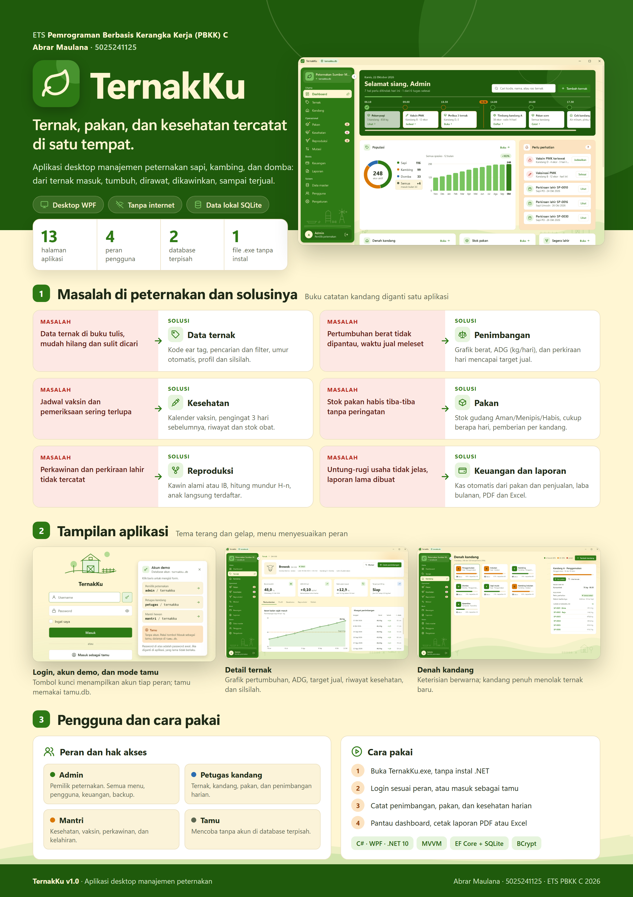
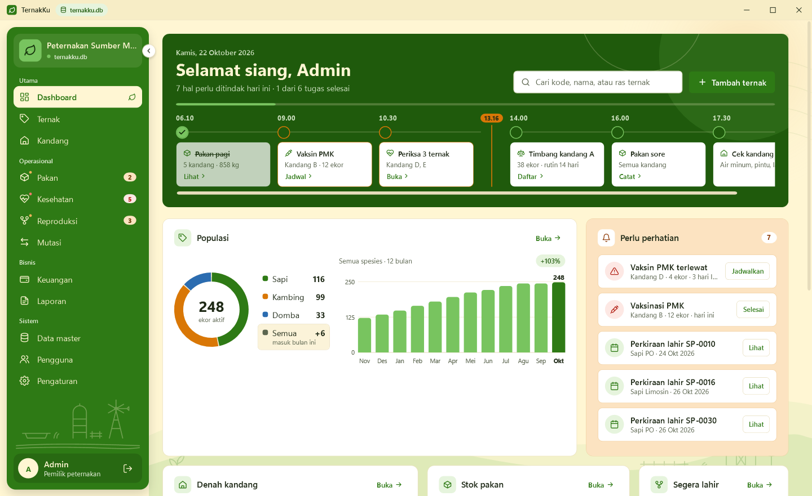
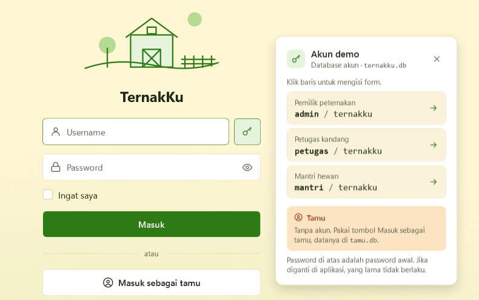
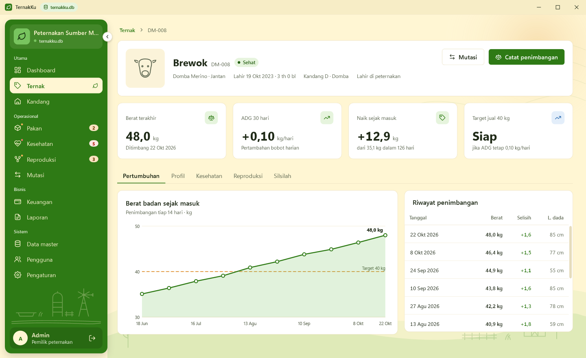
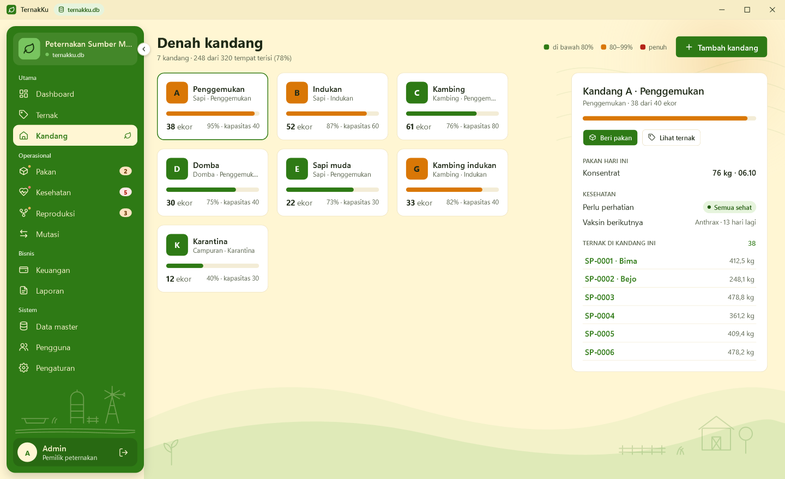
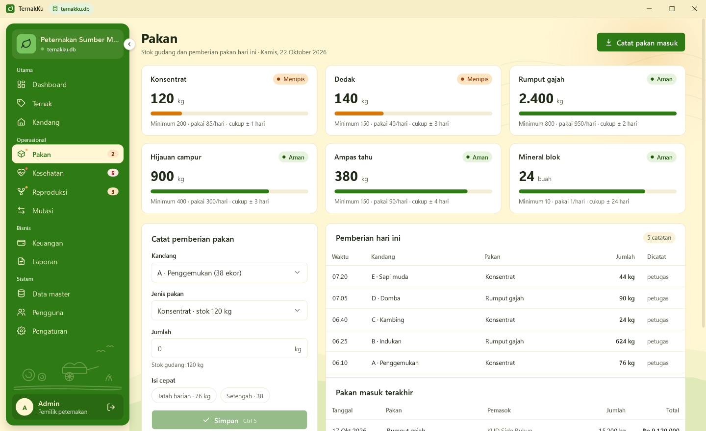
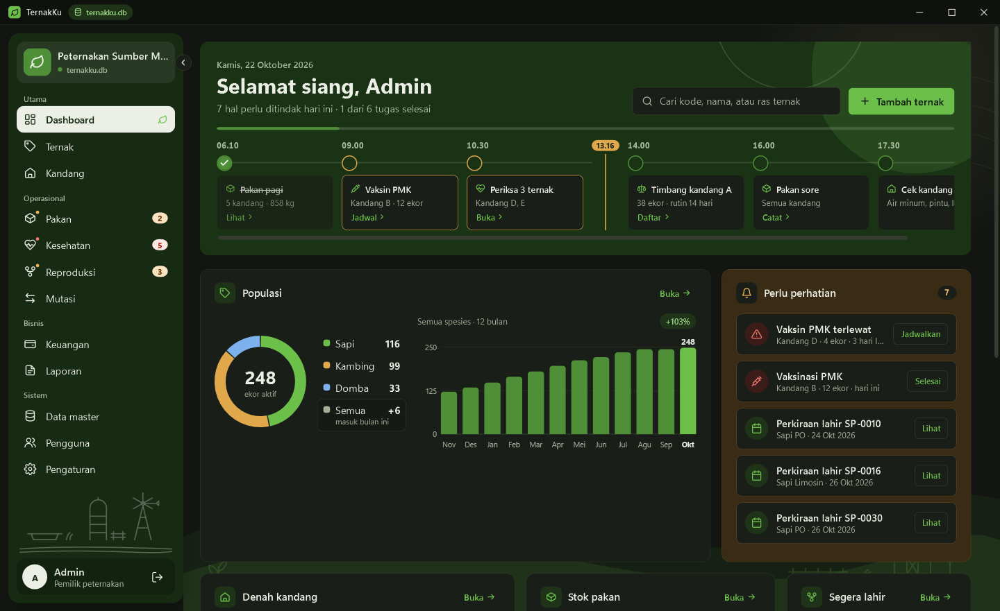

# ETS — TernakKu

$${\color{green}\Huge\textsf{Video demo, poster, dan jawaban soal ada di README ini}}$$

> [!IMPORTANT]
> **Isi README ini, urut dari atas:**
> 1. [Video demo](#video-demo) — tonton di YouTube: https://youtu.be/SGxj5KjVL5Q
> 2. [Poster infografis](#poster-infografis) — PNG dan PDF satu halaman
> 3. [Jawaban soal 1–3](#jawaban-soal)

---

## Video demo

[](https://youtu.be/SGxj5KjVL5Q)

Tonton di YouTube: **https://youtu.be/SGxj5KjVL5Q**

---

## Poster infografis



File poster: [PNG](Poster/Poster-TernakKu.png) · [PDF](Poster/Poster-TernakKu.pdf) · [sumber HTML](Poster/poster.html)

---

## Jawaban Soal

### 1. Perbedaan aplikasi desktop dengan aplikasi lain dan mengapa masih dibutuhkan

Aplikasi desktop dipasang dan berjalan langsung di komputer pengguna (Windows, macOS, Linux), memakai prosesor, memori, dan penyimpanan komputer itu sendiri. Aplikasi web berjalan di server dan dibuka lewat browser, sedangkan aplikasi mobile dipasang di ponsel atau tablet.

| Aspek | Aplikasi desktop | Aplikasi web | Aplikasi mobile |
| --- | --- | --- | --- |
| Tempat berjalan | Di komputer pengguna | Di server, dibuka lewat browser | Di ponsel atau tablet |
| Instalasi | Dipasang sekali (installer atau .exe) | Tanpa instalasi, cukup buka alamat web | Dipasang dari Play Store atau App Store |
| Koneksi internet | Bisa berjalan penuh tanpa internet | Wajib online | Sebagian bisa offline, umumnya butuh internet |
| Penyimpanan data | Lokal (file atau database di komputer) | Di server atau cloud | Lokal di ponsel dan atau di server |
| Performa | Cepat, memakai penuh CPU, RAM, dan disk | Bergantung kecepatan jaringan dan server | Dibatasi baterai dan layar kecil |
| Akses perangkat keras | Penuh: file lokal, printer, scanner, USB | Terbatas oleh izin browser | Kamera, GPS, sensor; akses file terbatas |
| Tampilan dan input | Layar besar, keyboard, mouse, banyak jendela | Mengikuti browser, menyesuaikan layar | Layar sentuh kecil, satu layar per tugas |
| Pembaruan | Pengguna memasang versi baru | Otomatis dari server, semua pengguna sekaligus | Lewat toko aplikasi |
| Biaya operasional | Tanpa biaya server atau hosting | Butuh server, domain, dan hosting | Biaya toko aplikasi dan biasanya server |
| Contoh | Microsoft Excel, Visual Studio, aplikasi kasir | Gmail, Google Docs, SIAKAD kampus | WhatsApp, Gojek, mobile banking |

**Mengapa aplikasi desktop masih dibutuhkan**

- **Bisa bekerja tanpa internet.** Banyak tempat usaha, termasuk peternakan di desa, sinyalnya lemah atau tidak ada; aplikasi desktop tetap bisa dipakai penuh.
- **Data milik dan berada di tangan pengguna.** Data tersimpan di komputer sendiri, tidak bergantung pada server pihak lain, dan bisa dibackup cukup dengan menyalin file.
- **Cepat dan stabil untuk input data dalam jumlah banyak.** Tabel besar, keyboard, shortcut (misalnya Ctrl+S, Ctrl+N), dan layar lebar membuat pencatatan harian lebih cepat daripada di ponsel.
- **Akses penuh ke perangkat komputer.** Mencetak laporan ke printer atau PDF, menyimpan file ekspor, dan membaca file lokal tanpa batasan browser.
- **Tanpa biaya bulanan.** Tidak perlu menyewa server, domain, atau hosting, cocok untuk usaha kecil dan menengah.
- **Masih menjadi standar untuk pekerjaan berat.** Aplikasi kantor, desain, pemrograman, kasir, dan sistem administrasi di banyak instansi tetap berbentuk desktop.

Karena alasan tersebut, TernakKu dibuat sebagai aplikasi desktop: dipakai di satu komputer peternakan, berjalan offline, dan datanya tersimpan di database SQLite lokal.

### 2. Problem yang diselesaikan dan fitur solusinya

Peternak kecil dan menengah masih mencatat ternak di buku tulis atau ingatan. Akibatnya data sulit dicari, jadwal penting terlewat, dan pemilik tidak tahu apakah usahanya untung atau rugi. TernakKu menggantikan buku catatan kandang itu dengan satu aplikasi yang mencatat, mengingatkan, dan merekap secara otomatis.

| No | Problem di peternakan | Dampaknya | Fitur TernakKu sebagai solusi |
| --- | --- | --- | --- |
| 1 | Data ternak ditulis di buku, mudah rusak, hilang, dan sulit dicari | Asal-usul, umur, dan riwayat seekor ternak tidak bisa dilacak | **Data ternak**: daftar ternak dengan kode ear tag unik, pencarian, filter spesies/kandang/status, umur dihitung otomatis, profil dan silsilah induk-pejantan |
| 2 | Pertumbuhan berat tidak dipantau | Ternak yang pertumbuhannya lambat tidak ketahuan, waktu jual tidak tepat | **Penimbangan**: catat berat dan lingkar dada, grafik pertumbuhan, ADG (pertambahan bobot harian) dan perkiraan hari mencapai target jual |
| 3 | Jadwal vaksin dan pemeriksaan sering lupa | Ternak sakit atau tertular penyakit, biaya obat naik | **Kesehatan**: riwayat pemeriksaan dan pengobatan, kalender jadwal vaksin, pengingat 3 hari sebelumnya, status terlewat otomatis, stok obat berkurang saat dipakai |
| 4 | Stok pakan habis tiba-tiba | Ternak telat makan, pembelian mendadak lebih mahal | **Pakan**: stok gudang dengan status Aman/Menipis/Habis, perkiraan stok cukup berapa hari, pemberian pakan per kandang yang langsung mengurangi stok dan menolak jumlah melebihi stok |
| 5 | Perkawinan dan perkiraan lahir tidak tercatat | Kelahiran tidak dipersiapkan, anak tidak terdaftar | **Reproduksi**: catat kawin alami atau IB, perkiraan lahir otomatis sesuai masa bunting spesies, hitung mundur H-n, kelahiran langsung mendaftarkan anak beserta induknya |
| 6 | Kandang terlalu penuh tanpa disadari | Ternak stres dan mudah sakit | **Denah kandang**: keterisian tiap kandang berwarna (hijau < 80%, kuning 80–99%, merah penuh), kandang penuh tidak bisa menerima ternak baru |
| 7 | Pindah, jual, dan kematian ternak tidak terdokumentasi | Jumlah ternak di buku berbeda dengan di kandang | **Mutasi**: catat pindah kandang, penjualan, dan kematian beserta penyebabnya; ternak nonaktif tidak bisa dipilih lagi |
| 8 | Untung-rugi usaha tidak jelas | Pemilik tidak bisa mengambil keputusan usaha | **Keuangan**: pemasukan dan pengeluaran, otomatis terisi dari pembelian pakan dan penjualan ternak, grafik arus kas 6 bulan, laba bersih dan pengeluaran per kategori |
| 9 | Membuat laporan memakan waktu lama | Rekap untuk pemilik atau mitra terlambat | **Laporan**: laporan data ternak, kesehatan, keuangan, dan pakan per periode, pratinjau, simpan PDF dan ekspor ke Excel (CSV) |
| 10 | Semua orang bisa mengubah semua data | Data salah atau sengaja diubah oleh yang tidak berwenang | **Pengguna dan hak akses**: login dengan password ter-hash (BCrypt), tiga peran (Admin, Petugas kandang, Mantri) dengan menu sesuai tugasnya, setiap catatan menyimpan siapa yang menginput |
| 11 | Calon pengguna ingin mencoba tanpa merusak data asli | Data asli tercampur data percobaan | **Mode tamu**: masuk tanpa akun memakai database terpisah (tamu.db) yang tidak tercampur dengan database akun (ternakku.db) |
| 12 | Pemilik harus membuka banyak catatan untuk tahu kondisi hari ini | Hal mendesak terlewat | **Dashboard**: sapaan, timeline tugas hari ini, pengingat (vaksin, stok menipis, perkiraan lahir), populasi per spesies, denah kandang, stok pakan, laba bulan ini, dan penimbangan terbaru dalam satu layar |

**Pengguna dan hak aksesnya**

| Peran | Siapa | Menu yang bisa dibuka |
| --- | --- | --- |
| Admin | Pemilik peternakan | Semua menu, termasuk Pengguna, Keuangan, Laporan, backup dan restore database |
| Petugas kandang | Anak kandang | Dashboard, Ternak, Kandang, Pakan, Pengaturan; boleh mencatat penimbangan dan pemberian pakan |
| Mantri | Petugas kesehatan hewan | Dashboard, Ternak, Kandang, Kesehatan, Reproduksi, Pengaturan |
| Tamu | Pengguna yang mencoba aplikasi | Semua menu kecuali Pengguna, hanya pada database tamu |

**Fitur pendukung**

- **Ingat saya**: aplikasi langsung terbuka tanpa login ulang setelah ditutup.
- **Akun demo di layar login**: tombol kunci di samping kolom username menampilkan akun tiap peran.
- **Tema terang dan gelap**, kepadatan tabel nyaman atau padat, dan menu samping yang bisa diciutkan.
- **Batalkan (undo)** setelah menyimpan data, serta backup dan pulihkan file database.

### 3. Poster infografis

Poster satu halaman ukuran A4 (2480 × 3508 px, 300 dpi) berisi masalah dan solusi, tampilan aplikasi, peran pengguna, dan cara pakai. Posternya ditampilkan di bagian [Poster infografis](#poster-infografis) di atas.

- Gambar: [Poster/Poster-TernakKu.png](Poster/Poster-TernakKu.png)
- PDF: [Poster/Poster-TernakKu.pdf](Poster/Poster-TernakKu.pdf)
- Sumber HTML: [Poster/poster.html](Poster/poster.html)

---

## Informasi Tugas

| | |
|---|---|
| **Mata Kuliah** | Pemrograman Berbasis Kerangka Kerja (PBKK C) |
| **Jenis Tugas** | Evaluasi Tengah Semester (ETS) |
| **Nama** | Abrar Maulana |
| **NRP** | 5025241125 |
| **Aplikasi** | TernakKu v1.0 — aplikasi desktop manajemen peternakan dengan C# WPF |
| **Tools** | Visual Studio 2026, .NET SDK 10, C#, WPF, SQLite |

| Tautan | |
|---|---|
| **Video demo** | https://youtu.be/SGxj5KjVL5Q |
| **Source code** | Repository ini |
| **Aplikasi (.exe)** | [isi tautan Google Drive atau GitHub Releases] |
| **Poster** | [PNG](Poster/Poster-TernakKu.png) · [PDF](Poster/Poster-TernakKu.pdf) |

TernakKu adalah aplikasi desktop WPF untuk mencatat seluruh siklus ternak sapi, kambing, dan domba: dari ternak masuk, tumbuh, dirawat, dikawinkan, sampai terjual. Semua data tersimpan di database SQLite lokal, sehingga aplikasi berjalan penuh tanpa internet.

---

## Tampilan Aplikasi

**Dashboard** — sapaan dan timeline tugas hari ini, populasi, pengingat, denah kandang, stok pakan, dan laba bulan ini.



**Login dan akun demo** — tombol kunci menampilkan akun tiap peran; tombol "Masuk sebagai tamu" memakai database terpisah.



**Detail ternak** — grafik pertumbuhan, ADG 30 hari, target jual, dan tab Profil, Kesehatan, Reproduksi, Silsilah.



**Denah kandang** — keterisian tiap kandang dan panel detail kandang terpilih.



**Pakan** — stok gudang, form pemberian pakan harian, dan riwayat pakan masuk.



**Tema gelap**



---

## Struktur Folder

```
ETS TernakKu/
├── README.md                      ← laporan ini
├── TernakKu.slnx                  ← solution, buka dengan Visual Studio 2026
├── THIRD-PARTY-NOTICES.md         ← lisensi pustaka dan ikon
├── Poster/                        ← poster infografis (PNG, PDF, HTML) dan screenshot
├── UI Prototype/                  ← prototipe desain HTML (dibuka di browser)
└── src/
    ├── TernakKu.Core/             ← model data dan aturan bisnis (tanpa UI dan database)
    │   ├── Models/                ← entitas: Ternak, Kandang, Pakan, Kesehatan, Perkawinan, Keuangan, ...
    │   └── Rules/AturanBisnis.cs  ← ADG, umur, perkiraan lahir, status stok, keterisian kandang
    ├── TernakKu.Data/             ← Entity Framework Core + SQLite
    │   ├── TernakDbContext.cs
    │   ├── Database.cs            ← dua file database: ternakku.db (akun) dan tamu.db (tamu)
    │   └── Seeder.cs              ← data contoh dan akun demo
    └── TernakKu.App/              ← aplikasi WPF (MVVM)
        ├── Views/                 ← Login, Shell (menu samping), halaman, dialog
        ├── ViewModels/            ← logika tiap halaman dan dialog
        ├── Controls/              ← ikon, grafik, badge, konverter
        ├── Services/              ← sesi login, pengaturan, tema, format angka dan tanggal
        ├── Themes/                ← warna terang/gelap, style kontrol, ikon
        └── Assets/TernakKu.ico    ← logo aplikasi
```

---

## Cara Menjalankan

**Dari source code**

1. Buka `TernakKu.slnx` di Visual Studio 2026 (workload **.NET desktop development**).
2. Pastikan **TernakKu.App** menjadi startup project.
3. Tekan **F5**. Paket NuGet terunduh otomatis saat build pertama.

Atau lewat terminal:

```bash
dotnet run --project src/TernakKu.App/TernakKu.App.csproj
```

**Membuat satu file .exe** (tanpa perlu instal .NET di komputer lain):

```bash
dotnet publish src/TernakKu.App/TernakKu.App.csproj -c Release -r win-x64 --self-contained true -p:PublishSingleFile=true -p:IncludeNativeLibrariesForSelfExtract=true -p:EnableCompressionInSingleFile=true -o publish
```

Saat pertama kali dibuka, aplikasi membuat `ternakku.db` dan `tamu.db` berisi data contoh di `%LOCALAPPDATA%\TernakKu`.

**Akun demo** (juga tampil lewat tombol kunci di layar login)

| Peran | Username | Password |
| --- | --- | --- |
| Admin | admin | ternakku |
| Petugas kandang | petugas | ternakku |
| Mantri | mantri | ternakku |
| Tamu | tanpa akun, tombol "Masuk sebagai tamu" | — |

---

## Teknologi

| Kebutuhan | Pilihan |
| --- | --- |
| Framework | .NET 10 + WPF (C#, XAML) |
| Pola arsitektur | MVVM dengan CommunityToolkit.Mvvm 8.4.2 |
| Database | SQLite lewat Entity Framework Core 10 |
| Keamanan password | BCrypt.Net-Next 4.2.0 |
| Grafik | Digambar sendiri (tanpa pustaka chart) |
| Distribusi | Satu file `TernakKu.exe` self-contained untuk Windows 10/11 64-bit |

Lisensi pustaka dan ikon pihak ketiga ada di [THIRD-PARTY-NOTICES.md](THIRD-PARTY-NOTICES.md).
