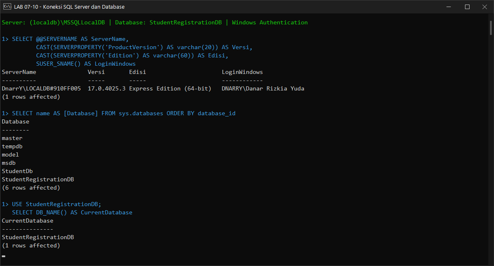
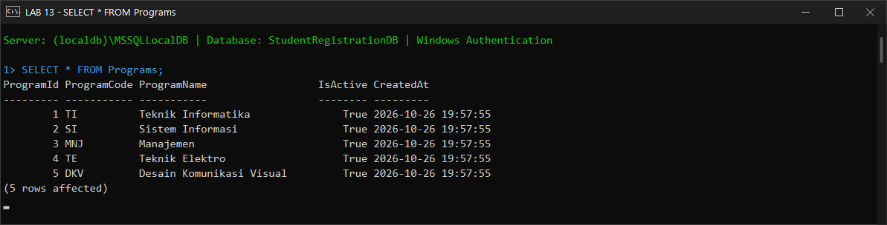
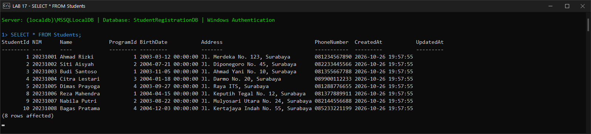
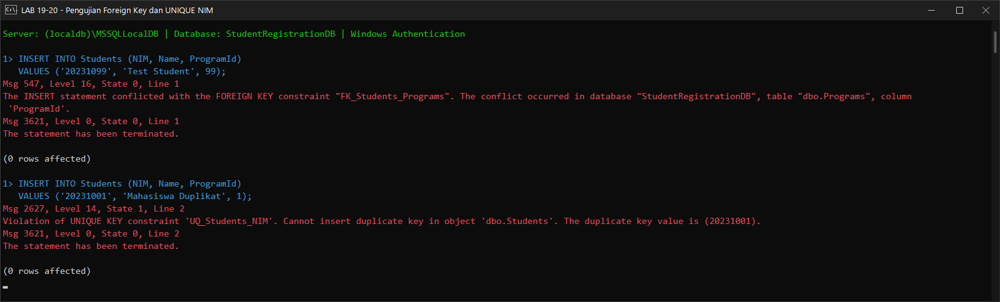
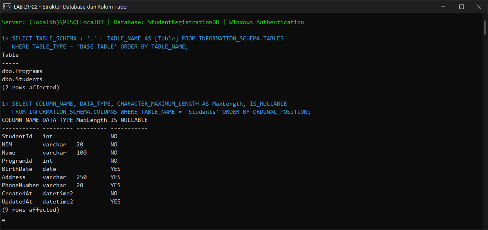
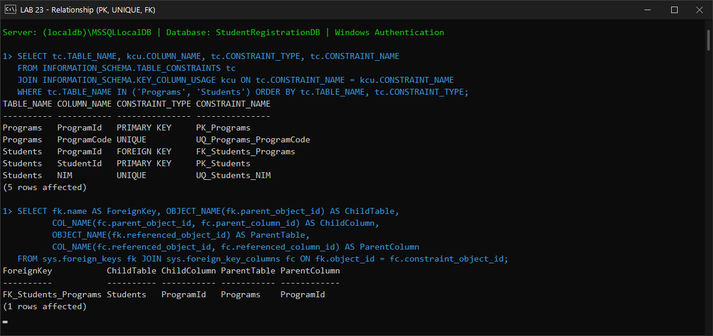
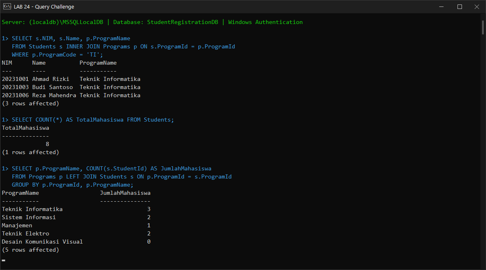
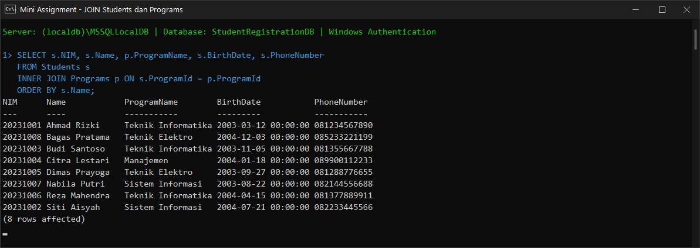
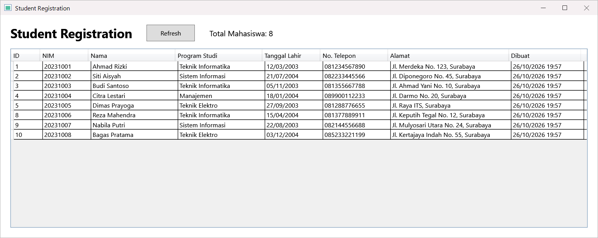
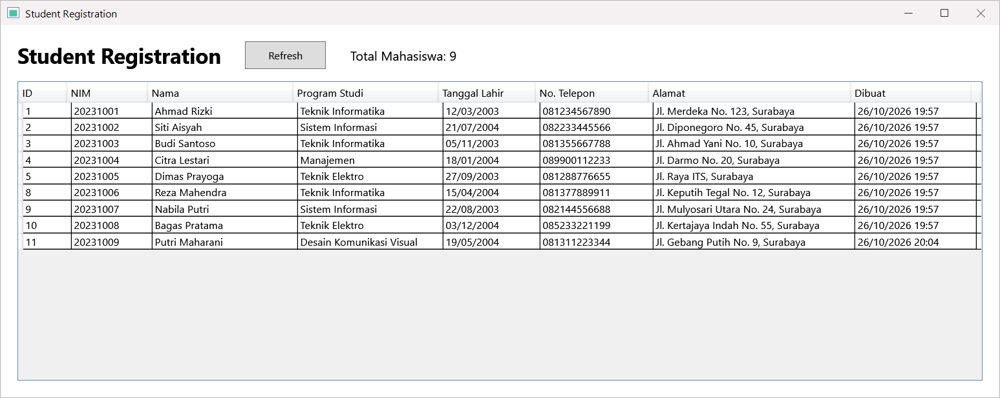

# Laporan Praktikum — Hands-On Lab 1 & 2

## Student Registration: Database SQL Server + Aplikasi WPF dengan ADO.NET

| | |
|---|---|
| **Mata Kuliah** | .NET Framework Programming (PBKK C) |
| **Topik** | SQL Server, Database Relasional, ADO.NET, WPF |
| **Nama** | Danar Rizkia Yuda |
| **NRP** | 5025241128 |
| **Tools** | Visual Studio / .NET SDK 10, C#, WPF, SQL Server Express LocalDB, Microsoft.Data.SqlClient |

---

## Tujuan Praktikum

Hands-On Lab 1 dan Lab 2 adalah satu rangkaian: Lab 1 menyiapkan database `StudentRegistrationDB`, lalu Lab 2 membuat aplikasi WPF yang membaca data dari database tersebut.

```
Lab 1                                   Lab 2
SQL Server                              WPF (MainWindow)
   │                                       │
   ▼                                       ▼
StudentRegistrationDB  ◄──── ADO.NET ──── StudentRepository
   ├── Programs  (1)
   └── Students  (N)
```

Setelah praktikum, mahasiswa mampu:

- Menyiapkan SQL Server dan terhubung menggunakan Windows Authentication.
- Membuat database dan tabel dengan PRIMARY KEY, UNIQUE, dan FOREIGN KEY.
- Memahami relasi One-to-Many (1:N) antara `Programs` dan `Students`.
- Menjalankan query `INSERT`, `SELECT`, `JOIN`, `WHERE`, `COUNT`, dan `GROUP BY`.
- Membuat project WPF dengan Model (`Student`, `Program`) dan `StudentRepository`.
- Mengambil data SQL Server dengan `SqlConnection`, `SqlCommand`, dan `SqlDataReader`.
- Menampilkan data mahasiswa pada `DataGrid` dengan tombol **Refresh**.

---

## Struktur Folder

```
Tugas 6/
├── README.md                              ← laporan ini
├── image-*.png                            ← screenshot hasil praktikum
├── Database/
│   ├── StudentRegistrationDB.sql          ← seluruh script praktikum Lab 1 (+ Mini Assignment)
│   └── cek-database.bat / .ps1            ← cek koneksi & isi database (klik dua kali)
└── StudentRegistration/                   ← project WPF Lab 2
    ├── Models/
    │   ├── Student.cs                     ← model data mahasiswa
    │   └── Program.cs                     ← model program studi
    ├── Repositories/
    │   └── StudentRepository.cs           ← data access ke SQL Server (ADO.NET)
    ├── MainWindow.xaml                    ← UI WPF (DataGrid + Refresh)
    ├── MainWindow.xaml.cs                 ← event & UI logic
    ├── App.xaml / App.xaml.cs
    ├── AssemblyInfo.cs
    └── StudentRegistration.csproj
```

## Cara Menjalankan

1. Pastikan instance SQL Server LocalDB aktif (PowerShell / Command Prompt):

   ```powershell
   sqllocaldb start MSSQLLocalDB
   ```

2. Jalankan script database `Database/StudentRegistrationDB.sql` lewat SSMS (**New Query** → buka file → **Execute / F5**) atau lewat terminal:

   ```bash
   sqlcmd -S "(localdb)\MSSQLLocalDB" -E -i Database/StudentRegistrationDB.sql
   ```

   Script aman dijalankan ulang: database, tabel, dan data hanya dibuat jika belum ada.
3. Jalankan aplikasi WPF: buka `StudentRegistration/StudentRegistration.csproj` di Visual Studio lalu tekan **F5**, atau:

   ```bash
   dotnet run --project StudentRegistration
   ```

4. Untuk mengecek isi database dengan cepat, klik dua kali `Database/cek-database.bat`.

---

# HANDS-ON LAB 1 — Database Student Registration dengan SQL Server

## LAB 01–05 — Menyiapkan dan Menginstal SQL Server

SQL Server yang digunakan adalah **SQL Server Express (LocalDB)** dengan konfigurasi:

| Pengaturan | Nilai |
|---|---|
| Feature Selection | Database Engine Services |
| Instance | `(localdb)\MSSQLLocalDB` / `.\SQLEXPRESS` |
| Nama server lokal | `(localdb)\MSSQLLocalDB` |
| Authentication | Windows Authentication |

```
Windows User
    ↓
Windows Authentication
    ↓
SQL Server ((localdb)\MSSQLLocalDB)
```

## LAB 06–08 — Terhubung ke SQL Server

Koneksi dilakukan ke server `(localdb)\MSSQLLocalDB` dengan **Windows Authentication** (Trust Server Certificate). Query yang dijalankan dalam lab ini dieksekusi melalui `sqlcmd`/PowerShell (ADO.NET); query yang sama dapat dijalankan langsung di SSMS lewat **New Query**.

| Field | Nilai |
|---|---|
| Server type | Database Engine |
| Server name | `(localdb)\MSSQLLocalDB` |
| Authentication | Windows Authentication |

## LAB 09–10 — Membuat dan Menggunakan Database

```sql
IF DB_ID('StudentRegistrationDB') IS NULL
    CREATE DATABASE StudentRegistrationDB;
GO

USE StudentRegistrationDB;
GO

SELECT DB_NAME() AS CurrentDatabase;
```

Hasil: koneksi berhasil (server `DnarrY\LOCALDB`, SQL Server Express Edition 64-bit, login Windows `DNARRY\Danar Rizkia Yuda`), database `StudentRegistrationDB` terdaftar, dan `DB_NAME()` mengembalikan `StudentRegistrationDB`.



## LAB 11 — Membuat Tabel Programs

```sql
CREATE TABLE Programs
(
    ProgramId   INT IDENTITY(1,1) CONSTRAINT PK_Programs PRIMARY KEY,
    ProgramCode VARCHAR(20)  NOT NULL CONSTRAINT UQ_Programs_ProgramCode UNIQUE,
    ProgramName VARCHAR(100) NOT NULL,
    IsActive    BIT NOT NULL CONSTRAINT DF_Programs_IsActive DEFAULT 1,
    CreatedAt   DATETIME2 NOT NULL CONSTRAINT DF_Programs_CreatedAt DEFAULT SYSDATETIME()
);
```

```
Programs
├── ProgramId     → PRIMARY KEY (IDENTITY)
├── ProgramCode   → UNIQUE
├── ProgramName
├── IsActive      → DEFAULT 1
└── CreatedAt     → DEFAULT SYSDATETIME()
```

## LAB 12–13 — Memasukkan dan Melihat Data Program Studi

Lima program studi dimasukkan: `TI`, `SI`, `MNJ`, `TE`, dan `DKV`. Kolom `IsActive` dan `CreatedAt` terisi otomatis dari constraint `DEFAULT`.

```sql
SELECT * FROM Programs;
```



## LAB 14 — Membuat Tabel Students

```sql
CREATE TABLE Students
(
    StudentId   INT IDENTITY(1,1) CONSTRAINT PK_Students PRIMARY KEY,
    NIM         VARCHAR(20)  NOT NULL CONSTRAINT UQ_Students_NIM UNIQUE,
    Name        VARCHAR(100) NOT NULL,
    ProgramId   INT NOT NULL,
    BirthDate   DATE NULL,
    Address     VARCHAR(250) NULL,
    PhoneNumber VARCHAR(20)  NULL,
    CreatedAt   DATETIME2 NOT NULL CONSTRAINT DF_Students_CreatedAt DEFAULT SYSDATETIME(),
    UpdatedAt   DATETIME2 NULL,

    CONSTRAINT FK_Students_Programs
        FOREIGN KEY (ProgramId) REFERENCES Programs(ProgramId)
);
```

```
Students
├── StudentId     → PRIMARY KEY
├── NIM           → UNIQUE
├── Name
├── ProgramId     → FOREIGN KEY → Programs.ProgramId
├── BirthDate
├── Address
├── PhoneNumber
├── CreatedAt
└── UpdatedAt
```

## LAB 15 — Memahami Relasi 1:N

```
Programs
   │ 1
   │
   │ N
   ▼
Students
```

Satu program studi dapat memiliki banyak mahasiswa, sedangkan satu mahasiswa hanya memiliki satu `ProgramId`. Relasi ini dijaga oleh foreign key `FK_Students_Programs`.

## LAB 16–17 — Memasukkan dan Menampilkan Data Mahasiswa

Lima mahasiswa awal dimasukkan sesuai modul (Ahmad Rizki, Siti Aisyah, Budi Santoso, Citra Lestari, Dimas Prayoga), ditambah tiga mahasiswa dari **Mini Assignment** (lihat bagian di bawah).

```sql
SELECT * FROM Students;
```



> `StudentId` untuk tiga mahasiswa Mini Assignment adalah 8, 9, dan 10, bukan 6, 7, dan 8. Hal ini terjadi karena pengujian LAB 19 dan LAB 20 (INSERT yang ditolak) tetap memakai nilai `IDENTITY`. Ini perilaku normal SQL Server: nilai identity yang sudah dipakai tidak dikembalikan meskipun INSERT-nya gagal.

## LAB 18 — Menggabungkan Dua Tabel (JOIN)

```sql
SELECT s.StudentId, s.NIM, s.Name, p.ProgramCode, p.ProgramName, s.BirthDate, s.PhoneNumber
FROM Students s
INNER JOIN Programs p
    ON s.ProgramId = p.ProgramId;
```

`INNER JOIN` menggabungkan setiap baris `Students` dengan baris `Programs` yang `ProgramId`-nya sama, sehingga nama program studi bisa ditampilkan bersama data mahasiswa. Hasil JOIN ditunjukkan pada bagian Mini Assignment.

## LAB 19–20 — Pengujian Foreign Key dan UNIQUE NIM

```sql
-- LAB 19: ProgramId 99 tidak ada di tabel Programs
INSERT INTO Students (NIM, Name, ProgramId)
VALUES ('20231099', 'Test Student', 99);

-- LAB 20: NIM 20231001 sudah terdaftar
INSERT INTO Students (NIM, Name, ProgramId)
VALUES ('20231001', 'Mahasiswa Duplikat', 1);
```

| Uji | Hasil yang Diharapkan | Hasil Aktual | Status |
|---|---|---|---|
| Insert `ProgramId = 99` | Ditolak oleh FOREIGN KEY | `Msg 547` — conflicted with the FOREIGN KEY constraint `FK_Students_Programs` | ✅ Berhasil |
| Insert NIM `20231001` lagi | Ditolak oleh UNIQUE | `Msg 2627` — Violation of UNIQUE KEY constraint `UQ_Students_NIM` | ✅ Berhasil |

Hasil ini membuktikan bahwa foreign key menjaga integritas referensial, dan constraint UNIQUE mencegah NIM ganda.



> Di dalam file `StudentRegistrationDB.sql`, kedua pengujian ini dibungkus `BEGIN TRY ... END CATCH` supaya seluruh script tetap bisa dijalankan sampai selesai sambil menampilkan pesan error-nya.

## LAB 21–22 — Melihat Struktur Database dan Kolom Tabel

Database `StudentRegistrationDB` berisi tabel `dbo.Programs` dan `dbo.Students`. Kolom tabel `Students` sesuai rancangan: `StudentId`, `NIM`, `Name`, `ProgramId`, `BirthDate`, `Address`, `PhoneNumber`, `CreatedAt`, dan `UpdatedAt`.



## LAB 23 — Melihat Relationship

```
┌──────────────────┐
│     PROGRAMS     │
├──────────────────┤
│ PK ProgramId     │
│ UK ProgramCode   │
│    ProgramName   │
│    IsActive      │
└────────┬─────────┘
         │ 1
         │
         │ N
┌────────▼─────────┐
│     STUDENTS     │
├──────────────────┤
│ PK StudentId     │
│ UK NIM           │
│    Name          │
│ FK ProgramId     │
│    BirthDate     │
│    Address       │
│    PhoneNumber   │
│    CreatedAt     │
│    UpdatedAt     │
└──────────────────┘
```

Constraint yang terbentuk: `PK_Programs`, `UQ_Programs_ProgramCode`, `PK_Students`, `UQ_Students_NIM`, dan `FK_Students_Programs` (`Students.ProgramId` → `Programs.ProgramId`).



## LAB 24 — Query Challenge

| Challenge | Query | Hasil |
|---|---|---|
| 1. Seluruh mahasiswa | `SELECT * FROM Students;` | 8 baris (lihat LAB 17) |
| 2. Mahasiswa Teknik Informatika | `INNER JOIN` + `WHERE p.ProgramCode = 'TI'` | Ahmad Rizki, Budi Santoso, Reza Mahendra |
| 3. Jumlah mahasiswa | `SELECT COUNT(*) AS TotalMahasiswa FROM Students;` | 8 |
| 4. Jumlah per program studi | `LEFT JOIN` + `GROUP BY` | TI 3, SI 2, MNJ 1, TE 2, DKV 0 |

Challenge 4 memakai `LEFT JOIN` dari `Programs`, sehingga program studi yang belum memiliki mahasiswa (Desain Komunikasi Visual) tetap tampil dengan jumlah 0.



## LAB 25–26 — Persiapan Integrasi C# dan Connection String

```
WPF UI → Repository → ADO.NET → SQL Server → StudentRegistrationDB
```

```
Server=(localdb)\MSSQLLocalDB;
Database=StudentRegistrationDB;
Trusted_Connection=True;
TrustServerCertificate=True;
```

## Mini Assignment

Tiga mahasiswa baru ditambahkan: satu Teknik Informatika, satu Sistem Informasi, dan satu Teknik Elektro. `ProgramId` diambil dari `ProgramCode`, sehingga data tetap benar meskipun urutan ID program studi berbeda.

```sql
INSERT INTO Students (NIM, Name, ProgramId, BirthDate, Address, PhoneNumber)
SELECT '20231006', 'Reza Mahendra', ProgramId, '2004-04-15',
       'Jl. Keputih Tegal No. 12, Surabaya', '081377889911'
FROM Programs WHERE ProgramCode = 'TI';
-- 20231007 Nabila Putri (SI), 20231008 Bagas Pratama (TE)
```

| NIM | Nama | Program Studi |
|---|---|---|
| 20231006 | Reza Mahendra | Teknik Informatika |
| 20231007 | Nabila Putri | Sistem Informasi |
| 20231008 | Bagas Pratama | Teknik Elektro |

Query hasil (diurutkan berdasarkan nama):

```sql
SELECT s.NIM, s.Name, p.ProgramName, s.BirthDate, s.PhoneNumber
FROM Students s
INNER JOIN Programs p ON s.ProgramId = p.ProgramId
ORDER BY s.Name;
```



### Output yang Dikumpulkan (Lab 1)

| No | Output | Lokasi |
|---|---|---|
| 1 | Screenshot SQL Server berhasil terkoneksi | `image-1.png` |
| 2 | Screenshot database StudentRegistrationDB | `image-1.png`, `image-7.png` |
| 3 | Screenshot tabel Programs | `image-2.png` |
| 4 | Screenshot tabel Students | `image-3.png` |
| 5 | Screenshot hasil JOIN | `image-4.png` |
| 6 | File `.sql` berisi seluruh script praktikum | `Database/StudentRegistrationDB.sql` |

### Checkpoint Praktikum Lab 1

- [x] SQL Server berhasil terinstal.
- [x] SQL Server berhasil terkoneksi (Windows Authentication).
- [x] StudentRegistrationDB berhasil dibuat.
- [x] Tabel Programs berhasil dibuat.
- [x] Tabel Students berhasil dibuat.
- [x] Primary Key, Unique Key, dan Foreign Key berhasil diterapkan.
- [x] Data Program Studi berhasil dimasukkan.
- [x] Data Mahasiswa berhasil dimasukkan.
- [x] Query SELECT, JOIN, COUNT, WHERE, dan GROUP BY berhasil dijalankan.
- [x] Relasi 1:N dipahami dan diuji.

---

# HANDS-ON LAB 2 — Aplikasi WPF + C# Terhubung SQL Server dengan ADO.NET

## Prasyarat

Lab 2 memakai database hasil Lab 1. Sebelum memulai, dipastikan `SELECT * FROM Students` pada `StudentRegistrationDB` sudah menghasilkan data (lihat LAB 17).

## LAB 01–02 — Membuat Project WPF

Project dibuat dengan template **WPF Application**, bahasa **C#**, nama project **StudentRegistration**, framework **.NET 10**.

Setara dengan perintah CLI:

```bash
dotnet new wpf -n StudentRegistration
```

## LAB 03–05 — Membuat Folder Models, Student.cs, dan Program.cs

`Student.cs` merepresentasikan tabel `Students`. Properti `ProgramName` ditambahkan untuk menampung hasil JOIN dengan tabel `Programs`.

```csharp
namespace StudentRegistration.Models;

public class Student
{
    public int StudentId { get; set; }
    public string NIM { get; set; } = string.Empty;
    public string Name { get; set; } = string.Empty;
    public int ProgramId { get; set; }
    public string ProgramName { get; set; } = string.Empty;
    public DateTime? BirthDate { get; set; }
    public string Address { get; set; } = string.Empty;
    public string PhoneNumber { get; set; } = string.Empty;
    public DateTime CreatedAt { get; set; }
    public DateTime? UpdatedAt { get; set; }
}
```

`Program.cs` adalah model program studi, bukan file entry point aplikasi (entry point WPF dibuat otomatis dari `App.xaml`).

```csharp
public class Program
{
    public int ProgramId { get; set; }
    public string ProgramCode { get; set; } = string.Empty;
    public string ProgramName { get; set; } = string.Empty;
    public bool IsActive { get; set; }
}
```

Kolom yang nullable di database (`BirthDate`, `UpdatedAt`) dibuat nullable di C# (`DateTime?`).

## LAB 06 — Install Microsoft.Data.SqlClient

Package `Microsoft.Data.SqlClient` (versi 7.1.0, lisensi MIT) dipasang lewat NuGet:

```bash
dotnet add package Microsoft.Data.SqlClient --version 7.1.0
```

## LAB 07–10 — Membuat StudentRepository dan Connection String

`Repositories/StudentRepository.cs` berisi connection string dan method `GetAll()` yang menjalankan query JOIN, lalu memetakan setiap baris menjadi objek `Student`.

```csharp
private readonly string _connectionString =
    @"Server=(localdb)\MSSQLLocalDB;
      Database=StudentRegistrationDB;
      Trusted_Connection=True;
      TrustServerCertificate=True;";

public List<Student> GetAll()
{
    var students = new List<Student>();

    const string sql = """
        SELECT s.StudentId, s.NIM, s.Name, s.ProgramId, p.ProgramName,
               s.BirthDate, s.Address, s.PhoneNumber, s.CreatedAt, s.UpdatedAt
        FROM Students s
        INNER JOIN Programs p ON s.ProgramId = p.ProgramId
        ORDER BY s.StudentId;
        """;

    using var connection = new SqlConnection(_connectionString);
    using var command = new SqlCommand(sql, connection);
    connection.Open();
    using var reader = command.ExecuteReader();

    while (reader.Read())
    {
        students.Add(new Student
        {
            StudentId = reader.GetInt32(reader.GetOrdinal("StudentId")),
            NIM = reader.GetString(reader.GetOrdinal("NIM")),
            // ... kolom lain; kolom nullable dicek dengan reader.IsDBNull(...)
        });
    }

    return students;
}
```

## N. Memahami Alur Repository

```
GetAll()
   │
   ▼
SQL Query  →  SqlConnection  →  SqlCommand  →  ExecuteReader()
   │
   ▼
SqlDataReader  →  Student Object  →  List<Student>
```

## LAB 11 — Memahami ADO.NET

| Class | Fungsi |
|---|---|
| `SqlConnection` | Membuka koneksi ke SQL Server |
| `SqlCommand` | Menjalankan perintah SQL |
| `SqlDataReader` | Membaca hasil query baris per baris (forward-only) |

Semua objek dibuat dengan `using var`, sehingga koneksi, command, dan reader otomatis ditutup (`Dispose`) ketika method selesai, termasuk saat terjadi error.

## LAB 12 — Mendesain MainWindow

`MainWindow.xaml` berisi judul **Student Registration**, tombol **Refresh** (`RefreshButton_Click`), dan `DataGrid` `StudentDataGrid` dengan `AutoGenerateColumns="False"`, `IsReadOnly="True"`, dan `CanUserAddRows="False"`. Kolom yang ditampilkan: ID, NIM, Nama, Program Studi, Tanggal Lahir (`StringFormat=dd/MM/yyyy`), dan No. Telepon, ditambah kolom dari Mini Challenge.

## LAB 13 — Menghubungkan Repository dengan WPF

```csharp
public MainWindow()
{
    InitializeComponent();
    _studentRepository = new StudentRepository();
    LoadStudents();
}

private void LoadStudents()
{
    try
    {
        var students = _studentRepository.GetAll();
        StudentDataGrid.ItemsSource = students;
        TotalStudentText.Text = $"Total Mahasiswa: {_studentRepository.GetTotal()}";
    }
    catch (Exception ex)
    {
        MessageBox.Show(ex.Message, "Database Error",
            MessageBoxButton.OK, MessageBoxImage.Error);
    }
}

private void RefreshButton_Click(object sender, RoutedEventArgs e)
{
    LoadStudents();
}
```

Jika koneksi ke database gagal, error ditangkap dan ditampilkan lewat `MessageBox` "Database Error", sehingga aplikasi tidak crash.

## LAB 14 — Menjalankan Aplikasi

Aplikasi dijalankan dengan **F5**. DataGrid langsung menampilkan 8 mahasiswa dari database: data yang sama dengan hasil JOIN di Lab 1, beserta nama program studinya.



### Pengujian Tombol Refresh

Saat aplikasi sedang terbuka, satu mahasiswa ditambahkan langsung ke database (NIM `20231009`, Putri Maharani, Desain Komunikasi Visual). Setelah tombol **Refresh** diklik, data baru langsung muncul di DataGrid dan Total Mahasiswa berubah dari 8 menjadi 9 tanpa perlu menutup aplikasi. Data uji ini kemudian dihapus kembali agar database tetap sesuai hasil Lab 1.



## T–U. Jika DataGrid Kosong / Menguji Query Secara Terpisah

Langkah troubleshooting yang disiapkan:

1. Jalankan `Database/cek-database.bat` (atau `SELECT * FROM Students` di SSMS) dan pastikan data ada.
2. Pastikan `Server` pada connection string sesuai instance (`(localdb)\MSSQLLocalDB` atau `.\SQLEXPRESS`).
3. Pastikan nama database `StudentRegistrationDB`.
4. Pastikan package `Microsoft.Data.SqlClient` terpasang.
5. Jalankan query JOIN dari repository langsung di SQL Server. Query mengembalikan 8 baris, sesuai jumlah data, sehingga database dan query sudah benar.

## LAB 16–17 — Data Binding: Dari Database ke DataGrid

```xml
<DataGridTextColumn Header="NIM" Binding="{Binding NIM}"/>
```

`Binding="{Binding NIM}"` menghubungkan properti `Student.NIM` dengan kolom NIM pada DataGrid. Karena `ItemsSource` diisi `List<Student>`, setiap objek `Student` menjadi satu baris.

```
SQL Server ─SELECT→ SqlDataReader → Student Object → List<Student> → ItemsSource → DataGrid
```

## LAB 18 — Tanggung Jawab Class

| Class/File | Tanggung Jawab |
|---|---|
| `Student.cs` | Model data mahasiswa |
| `Program.cs` | Model program studi |
| `StudentRepository.cs` | Data access ke SQL Server |
| `MainWindow.xaml` | User Interface WPF |
| `MainWindow.xaml.cs` | Event dan UI logic tahap awal |

## LAB 19 — Mini Challenge

| Challenge | Implementasi | Status |
|---|---|---|
| 1. Tambahkan Address ke DataGrid | Kolom **Alamat** (`Binding Address`, lebar 250) | ✅ |
| 2. Tambahkan CreatedAt | Kolom **Dibuat** (`Binding CreatedAt, StringFormat=dd/MM/yyyy HH:mm`) | ✅ |
| 3. Tambahkan Total Mahasiswa | Method `GetTotal()` + `TextBlock` di samping tombol Refresh | ✅ |

Challenge 3 memakai query `SELECT COUNT(*) FROM Students;` dengan `ExecuteScalar()`, karena query ini hanya mengembalikan satu nilai:

```csharp
public int GetTotal()
{
    const string sql = "SELECT COUNT(*) FROM Students;";

    using var connection = new SqlConnection(_connectionString);
    using var command = new SqlCommand(sql, connection);
    connection.Open();

    return (int)command.ExecuteScalar();
}
```

Karena ukuran jendela 900 px dari modul tidak cukup untuk dua kolom tambahan, lebar window dinaikkan menjadi 1250 px supaya semua kolom terlihat tanpa scroll horizontal.

## LAB 20 — Assignment

| Fitur Minimal | Implementasi | Status |
|---|---|---|
| WPF Project | `StudentRegistration.csproj` (.NET 10, WPF) | ✅ |
| Student.cs | `Models/Student.cs` | ✅ |
| Program.cs | `Models/Program.cs` | ✅ |
| StudentRepository.cs | `Repositories/StudentRepository.cs` | ✅ |
| Connection String | `_connectionString` di `StudentRepository` | ✅ |
| SqlConnection | `new SqlConnection(_connectionString)` | ✅ |
| SqlCommand | `new SqlCommand(sql, connection)` | ✅ |
| SqlDataReader | `command.ExecuteReader()` | ✅ |
| `List<Student>` | Hasil `GetAll()` | ✅ |
| DataGrid | `StudentDataGrid` | ✅ |
| Tombol Refresh | `RefreshButton_Click` → `LoadStudents()` | ✅ |
| Data SQL Server berhasil ditampilkan | 8 mahasiswa tampil (lihat `image-9.png`) | ✅ |

## Checkpoint Hands-On Lab 2

**Database:** ✅ StudentRegistrationDB  ✅ Programs  ✅ Students

**C#:** ✅ Student.cs  ✅ Program.cs  ✅ StudentRepository.cs

**ADO.NET:** ✅ Microsoft.Data.SqlClient  ✅ SqlConnection  ✅ SqlCommand  ✅ SqlDataReader

**WPF:** ✅ MainWindow.xaml  ✅ DataGrid  ✅ Refresh Button  ✅ Data berhasil ditampilkan

## Alur Data: Dari SQL Server sampai DataGrid

```
1. User menjalankan aplikasi WPF
        ↓
2. MainWindow membuat StudentRepository
        ↓
3. Repository membuat SqlConnection
        ↓
4. SqlCommand menjalankan SELECT (JOIN Students + Programs)
        ↓
5. SqlDataReader membaca hasil SQL Server
        ↓
6. DataReader dipetakan menjadi object Student
        ↓
7. Object Student dimasukkan ke List<Student>
        ↓
8. List<Student> menjadi ItemsSource
        ↓
9. DataGrid menampilkan data
```
