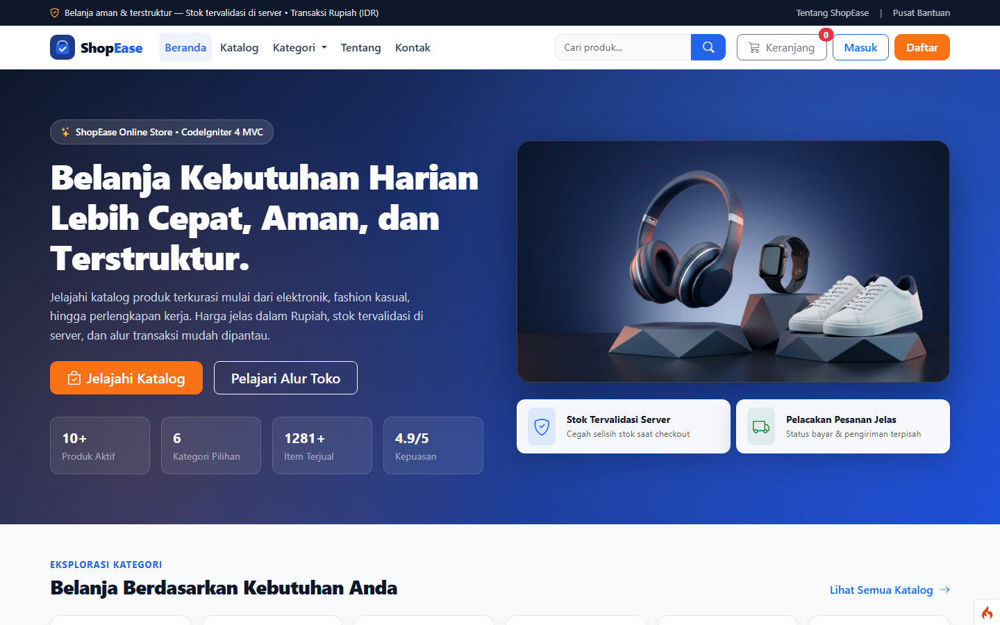
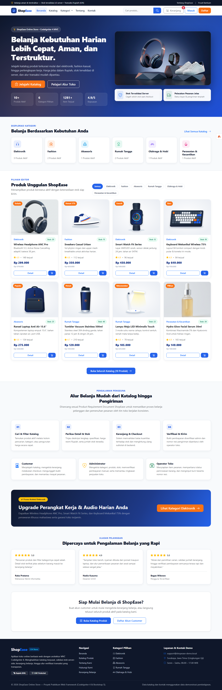
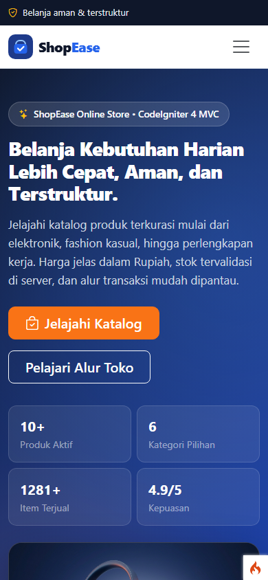
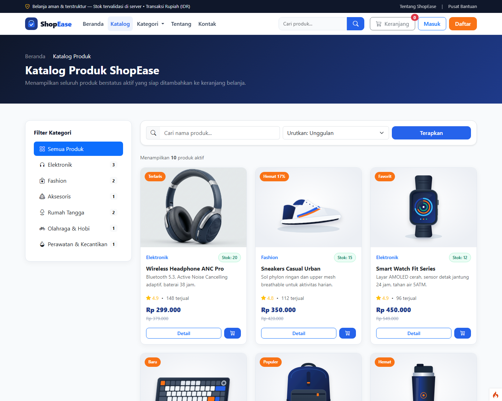
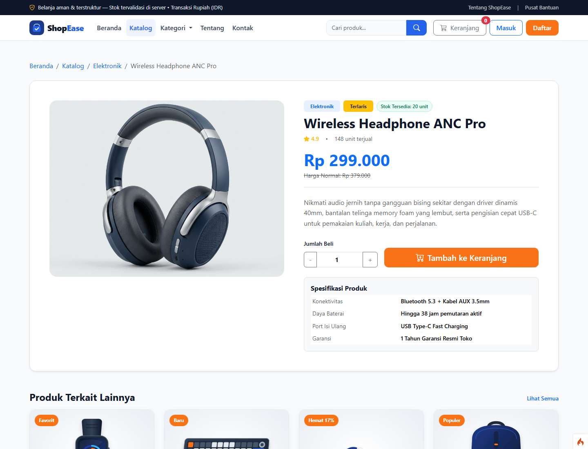
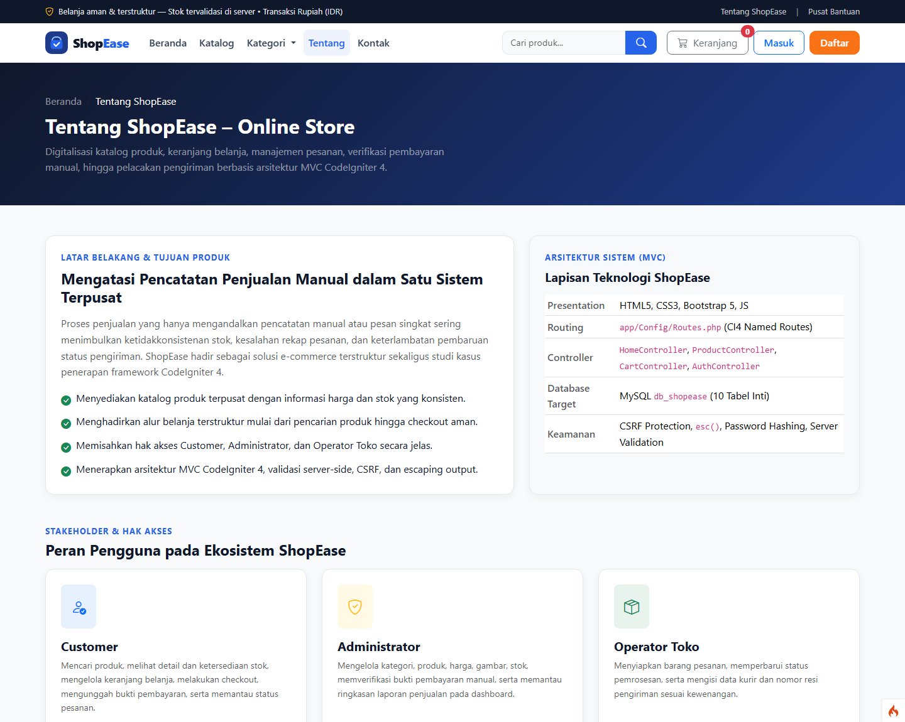
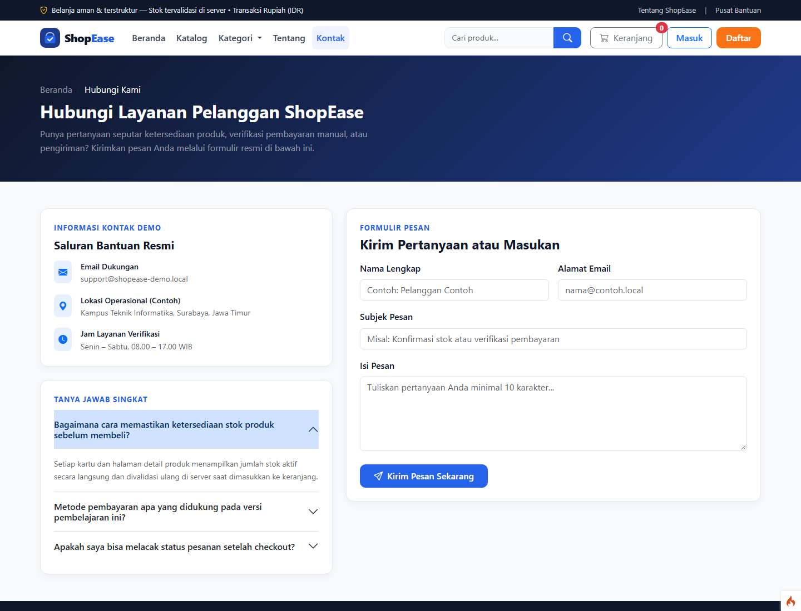
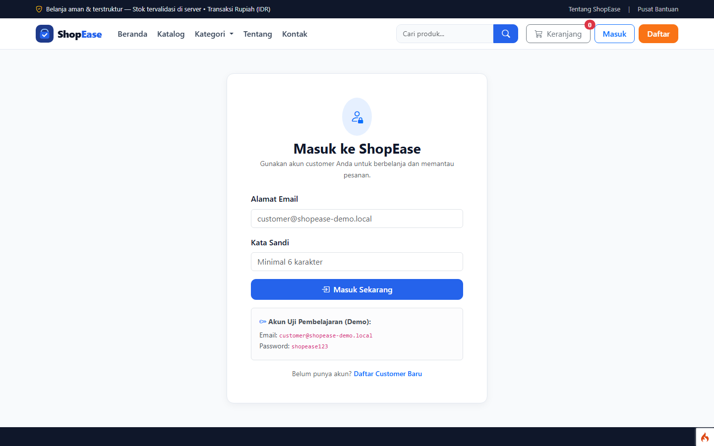

# Laporan Tugas 10 — Implementasi Landing Page, Routing, Controller, dan View ShopEase (CodeIgniter 4)

| Komponen | Keterangan |
|---|---|
| **Nama Mahasiswa** | Danar Rizkia Yuda |
| **NRP** | 5025241128 |
| **Mata Kuliah / Kelas** | Pemrograman Berbasis Kerangka Kerja (PBKK C) / Web Framework |
| **Aplikasi / Studi Kasus** | **ShopEase – Online Store** |
| **Framework & Stack** | CodeIgniter `v4.6.5`, PHP `8.1.10`, Bootstrap `5.3.3`, Bootstrap Icons `1.11.3`, MySQL Schema |
| **Referensi Dokumen** | `PRD_ShopEase_CodeIgniter4.docx` & `HOL_ShopEase_CodeIgniter4.docx` |

---

## 1. Ringkasan Tugas & Kesesuaian dengan PRD dan Hands-On Lab (HOL)

Tugas ini berfokus pada pembangunan **halaman Landing Page** beserta **modifikasi Routing, Controller, dan View** untuk aplikasi e-commerce **ShopEase – Online Store** menggunakan framework **CodeIgniter 4** di direktori `Tugas10/shopease/`.

Hasil pekerjaan telah diselaraskan terhadap dua dokumen acuan pada direktori `Tugas10/`:

1. **Kesesuaian dengan `PRD_ShopEase_CodeIgniter4.docx`**:
   - **Bab 10 (Spesifikasi Halaman & UI)**: Landing Page (`/`) memuat komponen Header, logo SVG brand, navigasi utama, form pencarian produk, Hero Banner, Kategori Pilihan, Produk Unggulan, Alur Belanja & Ekosistem Peran (Customer, Administrator, Operator), Banner Promo, Testimoni, CTA, dan Footer. Turut dilengkapi halaman Katalog (`/catalog`), Filter Kategori (`/category/{slug}`), Detail Produk (`/product/{slug}`), Keranjang (`/cart`), dan Login/Registrasi (`/login`, `/register`).
   - **Bab 8 (Business Rules)**:
     - **BR-002**: Produk berstatus `inactive` disaring dari homepage/katalog dan mengembalikan `404 Page Not Found` bila diakses langsung (`/product/produk-nonaktif-demo`).
     - **BR-003**: Kuantitas item keranjang minimal `1` dan tidak boleh melebihi stok produk aktif.
     - **BR-005**: Subtotal (`harga × kuantitas`) dan total belanja dihitung ulang di sisi server (`CartController`) berdasarkan data harga resmi pada katalog.
   - **Bab 11 (Rancangan Database)**: Disiapkan file SQL lengkap `shopease/database/db_shopease.sql` berisi 10 tabel inti (`users`, `categories`, `products`, `carts`, `cart_items`, `addresses`, `orders`, `order_items`, `payments`, `shipments`) beserta seed data demonstrasi.
   - **Bab 12 & 13 (Arsitektur & Keamanan)**: Pemisahan MVC bersih, `$autoRoute = false`, proteksi CSRF (`csrf_field()`) pada seluruh form `POST`, escaping output dengan `esc()`, serta validasi input server-side.

2. **Kesesuaian dengan `HOL_ShopEase_CodeIgniter4.docx` (Apakah aman?)**:
   - **Praktikum 1 (Setup Project CI4)**: Proyek dibangun menggunakan `codeigniter4/appstarter` versi `4.6.5` (kompatibel penuh dengan PHP `8.1.10`), file `.env` telah dikonfigurasi (`CI_ENVIRONMENT = development`, `app.baseURL = 'http://localhost:8080/'`, `app.indexPage = ''`, dan konfigurasi koneksi `db_shopease`), serta server lokal berjalan mulus melalui `php spark serve`.
   - **Praktikum 2 (Database & Tabel)**: Seluruh skema SQL 10 tabel dan seed data tersedia pada `shopease/database/db_shopease.sql` siap diimpor ke MySQL/Laragon. Untuk menjamin halaman Landing Page dan seluruh tampilan publik berjalan tanpa error meskipun layanan MySQL belum dinyalakan saat demonstrasi, data katalog juga dilayani secara konsisten melalui library terpusat `app/Libraries/StoreCatalog.php`.
   - **Praktikum 3 (Routing, Controller, dan View)**: Terpenuhi penuh sekaligus diperluas — `HomeController` menangani `index()` (Landing Page `/`), `about()` (`/about`), `contact()` (`/contact`), dan `sendContact()` (`POST /contact/send`), ditambah `ProductController`, `CartController`, dan `AuthController` agar seluruh tautan dari Landing Page berfungsi interaktif dan tidak menjadi tautan mati.

---

## 2. Struktur Direktori Proyek

```text
Tugas10/
├── HOL_ShopEase_CodeIgniter4.docx         <- Dokumen panduan Hands-On Lab
├── PRD_ShopEase_CodeIgniter4.docx         <- Dokumen Product Requirement Document
├── README.md                              <- Laporan pengerjaan & dokumentasi bukti
├── screenshots/                           <- 8 bukti screenshot eksekusi nyata
│   ├── 01-landing-page-hero.png
│   ├── 02-landing-page-full.png
│   ├── 03-landing-page-mobile.png
│   ├── 04-katalog-produk.png
│   ├── 05-detail-produk.png
│   ├── 06-halaman-about.png
│   ├── 07-halaman-contact.png
│   └── 08-halaman-login.png
└── shopease/                              <- Proyek utama CodeIgniter 4.6.5
    ├── .env                               <- Konfigurasi environment development & DB
    ├── database/
    │   └── db_shopease.sql                <- Skema 10 tabel + seed data PRD/HOL
    ├── app/
    │   ├── Config/
    │   │   ├── App.php                    <- $baseURL & $indexPage = '' (clean URL)
    │   │   ├── Routes.php                 <- Definisi 16 named routes ShopEase
    │   │   └── Routing.php                <- $autoRoute = false (ketat sesuai route)
    │   ├── Controllers/
    │   │   ├── BaseController.php         <- Helper url/form, session, & sharedViewData()
    │   │   ├── HomeController.php         <- Landing Page, About, Contact & sendContact
    │   │   ├── ProductController.php      <- Katalog, filter kategori, & detail produk
    │   │   ├── CartController.php         <- Keranjang session & hitung ulang di backend
    │   │   └── AuthController.php         <- Login, registrasi customer, & logout
    │   ├── Libraries/
    │   │   └── StoreCatalog.php           <- 6 kategori, 10 produk aktif, 1 nonaktif (BR-002)
    │   └── Views/
    │       ├── layouts/
    │       │   └── main.php               <- Master layout HTML5 + Bootstrap 5 + alert
    │       ├── partials/
    │       │   ├── navbar.php             <- Sticky header, logo SVG, search, cart badge
    │       │   ├── footer.php             <- Footer 4 kolom informasi toko
    │       │   └── product_card.php       <- Komponen kartu produk reusable (4:3)
    │       ├── frontend/
    │       │   ├── home.php               <- Landing Page ShopEase (6 bagian utama)
    │       │   ├── about.php              <- Halaman Tentang & arsitektur MVC
    │       │   ├── contact.php            <- Halaman Kontak, FAQ, & form validasi CSRF
    │       │   ├── catalog.php            <- Halaman Katalog (search, filter, sort)
    │       │   ├── product_detail.php     <- Detail produk, spesifikasi, stepper qty
    │       │   └── cart.php               <- Keranjang belanja & ringkasan total
    │       └── auth/
    │           ├── login.php              <- Halaman login customer + akun uji demo
    │           └── register.php           <- Halaman registrasi customer
    └── public/
        └── assets/
            ├── css/shopease.css           <- Styling tema Royal Indigo & Coral
            ├── js/shopease.js             <- Filter tab instan & stepper kuantitas
            ├── images/
            │   ├── hero-showcase.jpg      <- Visual hero studio e-commerce
            │   └── products/              <- 2 foto JPG studio + 8 ilustrasi SVG produk
            └── vendor/                    <- Bootstrap 5.3.3 & Bootstrap Icons 1.11.3 lokal
```

---

## 3. Rincian Modifikasi Routing, Controller, dan View

### 3.1 Modifikasi Routing (`shopease/app/Config/Routes.php`)

Route bawaan `Home::index` diganti dengan pemetaan route eksplisit memakai **named routes** dan **parameter placeholders** (`(:segment)`), sementara `$autoRoute` pada `app/Config/Routing.php` dipertahankan `false` dan `$indexPage` pada `app/Config/App.php` diatur menjadi `''` agar URL bersih tanpa `index.php`.

Daftar seluruh route yang diverifikasi melalui `php spark routes`:

| Method | URI Pattern | Route Name | Handler Controller | Fungsi |
|---|---|---|---|---|
| `GET` | `/` | `home` | `HomeController::index` | Halaman utama / Landing Page ShopEase |
| `GET` | `about` | `about` | `HomeController::about` | Halaman Tentang ShopEase (HOL Praktikum 3) |
| `GET` | `contact` | `contact` | `HomeController::contact` | Halaman Kontak & FAQ (HOL Praktikum 3) |
| `POST` | `contact/send` | `contact.send` | `HomeController::sendContact` | Validasi & pengiriman form kontak (CSRF) |
| `GET` | `catalog` | `catalog` | `ProductController::catalog` | Katalog produk publik (`?q=`, `?category=`, `?sort=`) |
| `GET` | `category/(:segment)` | `category.show` | `ProductController::category/$1` | Filter katalog per slug kategori |
| `GET` | `product/(:segment)` | `product.detail` | `ProductController::detail/$1` | Detail produk aktif (404 jika nonaktif) |
| `GET` | `cart` | `cart` | `CartController::index` | Tampilan keranjang belanja berbasis session |
| `POST` | `cart/add` | `cart.add` | `CartController::add` | Tambah item dengan validasi stok (BR-003) |
| `POST` | `cart/update` | `cart.update` | `CartController::update` | Ubah jumlah item keranjang |
| `POST` | `cart/remove` | `cart.remove` | `CartController::remove` | Hapus item dari keranjang |
| `GET` | `login` | `login` | `AuthController::login` | Formulir login pengguna |
| `POST` | `login` | `login.attempt` | `AuthController::attemptLogin` | Autentikasi `password_verify()` & session |
| `GET` | `register` | `register` | `AuthController::register` | Formulir registrasi customer baru |
| `POST` | `register` | `register.attempt` | `AuthController::attemptRegister` | Validasi & simpan customer dengan `password_hash()` |
| `GET` | `logout` | `logout` | `AuthController::logout` | Hapus session login & redirect ke `/` |

Output nyata perintah `php spark routes`:

```text
CodeIgniter v4.6.5 Command Line Tool - Server Time: 2026-11-24 18:22:15 UTC+00:00

+--------+------------------+------------------+--------------------------------------------------+----------------+---------------+
| Method | Route            | Name             | Handler                                          | Before Filters | After Filters |
+--------+------------------+------------------+--------------------------------------------------+----------------+---------------+
| GET    | /                | home             | \App\Controllers\HomeController::index           |                |               |
| GET    | about            | »                | \App\Controllers\HomeController::about           |                |               |
| GET    | contact          | »                | \App\Controllers\HomeController::contact         |                |               |
| GET    | catalog          | »                | \App\Controllers\ProductController::catalog      |                |               |
| GET    | category/([^/]+) | category.show    | \App\Controllers\ProductController::category/$1  |                |               |
| GET    | product/([^/]+)  | product.detail   | \App\Controllers\ProductController::detail/$1    |                |               |
| GET    | cart             | »                | \App\Controllers\CartController::index           |                |               |
| GET    | login            | »                | \App\Controllers\AuthController::login           |                |               |
| GET    | register         | »                | \App\Controllers\AuthController::register        |                |               |
| GET    | logout           | »                | \App\Controllers\AuthController::logout          |                |               |
| POST   | contact/send     | contact.send     | \App\Controllers\HomeController::sendContact     |                |               |
| POST   | cart/add         | cart.add         | \App\Controllers\CartController::add             |                |               |
| POST   | cart/update      | cart.update      | \App\Controllers\CartController::update          |                |               |
| POST   | cart/remove      | cart.remove      | \App\Controllers\CartController::remove          |                |               |
| POST   | login            | login.attempt    | \App\Controllers\AuthController::attemptLogin    |                |               |
| POST   | register         | register.attempt | \App\Controllers\AuthController::attemptRegister |                |               |
+--------+------------------+------------------+--------------------------------------------------+----------------+---------------+
```

### 3.2 Modifikasi Controller (`shopease/app/Controllers/`)

1. **`BaseController.php`**:
   - Memuat helper `['url', 'form']`, menginisialisasi `$this->session` dan `$this->catalog = new StoreCatalog()`.
   - Menyediakan `sharedViewData(string $activeNav)` untuk menyuplai `$categories`, `$cartCount`, `$currentUser`, `$activeNav`, dan `$searchQuery` ke layout utama dan navbar di seluruh halaman tanpa duplikasi kode.
2. **`HomeController.php`** *(HOL Praktikum 3)*:
   - `index()`: Mengambil 8 produk unggulan aktif, statistik toko (`10+` produk aktif, `6` kategori, `1281+` terjual, rating `4.9/5`), dan testimoni pelanggan lalu merender `frontend/home`.
   - `about()`: Menyajikan latar belakang masalah, tujuan produk, lapisan arsitektur MVC, serta matriks peran aktor PRD (`Customer`, `Administrator`, `Operator Toko`).
   - `contact()` & `sendContact()`: Menampilkan informasi kontak demo, akordeon FAQ, dan memvalidasi formulir pesan (`name`, `email`, `subject`, `message`) dengan aturan validasi CI4 dan umpan balik flashdata.
3. **`ProductController.php`**:
   - `catalog()` & `category(string $slug)`: Mendukung pencarian kata kunci (`q`), filter kategori, dan pengurutan (`featured`, `bestseller`, `price_asc`, `price_desc`, `name_asc`). Mengembalikan `404` via `PageNotFoundException` jika slug kategori tidak valid.
   - `detail(string $slug)`: Menampilkan informasi detail, spesifikasi teknis, status stok, dan 4 produk terkait. Menolak produk berstatus `inactive` dengan respons HTTP `404` (aturan **BR-002**).
4. **`CartController.php`**:
   - Mengelola item pada `session('shopease_cart')`, memvalidasi kuantitas terhadap stok produk aktif (`BR-003`), serta menghitung ulang subtotal dan total transaksi di backend (`BR-005`) tanpa mempercayai input harga dari browser.
5. **`AuthController.php`**:
   - Menangani halaman login dan registrasi customer, menggunakan `password_hash()` dan `password_verify()`, melakukan `session()->regenerate()` saat login/logout, serta menampilkan pesan error generik agar tidak membocorkan status registrasi email (PRD Bab 13).

### 3.3 Modifikasi View, Master Layout, dan Aset (`shopease/app/Views/` & `public/assets/`)

- **Master Layout & Partials**:
  - `layouts/main.php` menggunakan template inheritance CI4 (`extend`, `section`, `renderSection`, `include`) dan memuat aset **Bootstrap 5.3.3** serta **Bootstrap Icons 1.11.3** secara lokal dari `public/assets/vendor/`.
  - `partials/navbar.php` menyajikan logo SVG kustom, tautan navigasi responsif, dropdown kategori dinamis, form pencarian, badge keranjang, dan tombol autentikasi.
  - `partials/product_card.php` merender kartu produk konsisten rasio `4:3`, badge promo, indikator stok, rating, harga Rupiah terformat, tombol detail, dan tombol cepat tambah keranjang ber-CSRF.
  - `partials/footer.php` menyajikan footer 4 kolom berlatar gelap (`#0F172A`) dengan kontras teks terang (`text-light`) yang terbaca jelas.
- **Halaman Landing Page (`frontend/home.php`)**:
  1. **Hero Banner**: Headline utama, deskripsi singkat PRD, dual CTA (*Jelajahi Katalog* & *Pelajari Alur Toko*), 4 kartu statistik toko, gambar showcase studio `hero-showcase.jpg`, serta 2 kartu trust highlight.
  2. **Kategori Pilihan**: 6 kartu kategori interaktif dengan ikon berwarna aksen dan jumlah produk aktif dinamis.
  3. **Produk Unggulan**: Dilengkapi filter tab kategori instan sisi klien (`shopease.js`) dan 8 produk unggulan aktif dalam format Rupiah.
  4. **Alur Belanja & Ekosistem Peran**: 4 langkah *Customer User Journey* serta 3 kartu peran pengguna (*Customer*, *Administrator*, *Operator Toko*).
  5. **Banner Promo Koleksi Elektronik**: Mengarahkan pengunjung ke `/category/elektronik`.
  6. **Testimoni Pelanggan & CTA Penutup**: 3 kartu ulasan pelanggan contoh dan blok ajakan pendaftaran akun/eksplorasi katalog.

---

## 4. Hasil Pengujian & Verifikasi Fungsional

Seluruh pengujian dijalankan setelah suntingan terakhir terhadap server `php spark serve` pada `http://localhost:8080` dan browser Chromium headless (via Chrome DevTools Protocol):

### 4.1 Pemeriksaan Sintaks & Daftar Route
- **PHP Lint (`php -l`)**: Seluruh 29 file PHP di `app/Config/`, `app/Controllers/`, `app/Libraries/`, dan `app/Views/` lulus tanpa error sintaks (`No syntax errors detected`).
- **Route Table (`php spark routes`)**: Seluruh 16 route (`GET` dan `POST`) terdaftar lengkap tanpa konflik.
- **Kebersihan Session Path**: File `.env` memakai default `WRITEPATH . 'session'` (`writable/session`); direktori `public/null` terverifikasi tidak ada (`False`).

### 4.2 Pengujian Endpoint HTTP, Aset Statis, dan Aturan Bisnis

| Skenario Uji | Metode & Endpoint | Hasil Diharapkan | Hasil Aktual | Status |
|---|---|---|---|---|
| Landing Page | `GET /` | HTTP 200 tanpa error PHP | HTTP 200 (84.466 bytes, `clean=True`) | Lulus |
| Halaman Tentang | `GET /about` | HTTP 200 tanpa error PHP | HTTP 200 (49.364 bytes, `clean=True`) | Lulus |
| Halaman Kontak | `GET /contact` | HTTP 200 tanpa error PHP | HTTP 200 (50.304 bytes, `clean=True`) | Lulus |
| Katalog Lengkap | `GET /catalog` | HTTP 200 menampilkan produk aktif | HTTP 200 (75.723 bytes, `clean=True`) | Lulus |
| Pencarian Katalog | `GET /catalog?q=Headphone` | HTTP 200 hasil terfilter | HTTP 200 (51.523 bytes, `clean=True`) | Lulus |
| Filter Kategori | `GET /category/elektronik` | HTTP 200 kategori Elektronik | HTTP 200 (56.802 bytes, `clean=True`) | Lulus |
| Detail Produk Aktif | `GET /product/wireless-headphone-pro` | HTTP 200 detail + spesifikasi | HTTP 200 (59.192 bytes, `clean=True`) | Lulus |
| Halaman Keranjang | `GET /cart` | HTTP 200 | HTTP 200 (42.792 bytes, `clean=True`) | Lulus |
| Halaman Login & Register | `GET /login`, `GET /register` | HTTP 200 | HTTP 200 (44.457 & 44.714 bytes) | Lulus |
| Aturan Bisnis BR-002 | `GET /product/produk-nonaktif-demo` | HTTP 404 (produk nonaktif ditolak) | **HTTP 404** | Lulus |
| Tambah Keranjang + CSRF + Hitung Server (BR-005) | `POST /cart/add` (`product_id=1`, `qty=2`) | Redirect ke `/cart`, subtotal `Rp 598.000` | HTTP 200, `subtotal_598k_verified=True` | Lulus |
| Aset Vendor, CSS, JS, Gambar JPG/SVG | 9 aset di `/assets/*` | Semua aset HTTP 200 | Semua 9 aset HTTP 200 | Lulus |
| Responsivitas Desktop & Mobile | Viewport `1440×900` & `390×844` | Tidak ada horizontal overflow | `scrollWidth=1440` & `scrollWidth=390` | Lulus |

---

## 5. Bukti Pengerjaan (Screenshot Hasil Aplikasi)

Seluruh tangkapan layar berikut diambil langsung dari aplikasi CodeIgniter 4 yang berjalan di `http://localhost:8080`:

### 5.1 Landing Page — Hero & Navigasi (Desktop `1440×900`)
Menampilkan announcement bar, sticky header dengan logo SVG, pencarian, badge keranjang, hero banner berlatar gradien indigo-navy, statistik toko, dan showcase visual.



### 5.2 Landing Page — Tampilan Penuh (`1440×4459`)
Memperlihatkan seluruh bagian Landing Page secara utuh mulai dari Hero Banner, 6 Kategori Pilihan, 8 Produk Unggulan, Alur Belanja & 3 Peran Pengguna, Banner Promo Elektronik, Testimoni Pelanggan, CTA Penutup, hingga Footer 4 kolom.



### 5.3 Landing Page — Tampilan Responsif Mobile (`390×844`)
Membuktikan tata letak responsif pada layar smartphone (`scrollWidth=390` tanpa horizontal overflow), tombol hamburger menu, serta penyesuaian tumpukan tombol CTA dan kartu statistik.



### 5.4 Halaman Katalog Produk (`/catalog`)
Menampilkan sidebar filter kategori beserta jumlah produk aktif per kategori, bilah pencarian dan pengurutan harga/terlaris, serta grid kartu produk aktif.



### 5.5 Halaman Detail Produk (`/product/wireless-headphone-pro`)
Menampilkan breadcrumb navigasi kategori, foto studio produk, harga Rupiah & harga normal, indikator stok, stepper kuantitas, form tambah keranjang dengan CSRF token, tabel spesifikasi, dan produk terkait.



### 5.6 Halaman Tentang ShopEase (`/about`)
Menyajikan latar belakang permasalahan, tujuan pengembangan sistem, tabel lapisan arsitektur MVC CodeIgniter 4, serta penjelasan peran *Customer*, *Administrator*, dan *Operator Toko*.



### 5.7 Halaman Hubungi Kami (`/contact`)
Menampilkan informasi kontak layanan demo, akordeon Tanya Jawab Singkat (FAQ), dan formulir pengiriman pesan dengan validasi server-side serta proteksi CSRF.



### 5.8 Halaman Login Customer (`/login`)
Menampilkan antarmuka autentikasi yang selaras dengan tema utama lengkap dengan kredensial akun uji pembelajaran untuk demonstrasi.



---

## 6. Panduan Menjalankan Aplikasi

### Opsi A — Menggunakan Development Server CodeIgniter 4 (`php spark serve`)

1. Buka terminal (PowerShell / Command Prompt) lalu masuk ke folder proyek:
   ```powershell
   cd "e:\Tugas Kuliah Semester 5\PBKK\Tugas10\shopease"
   ```
2. Jalankan server pengembangan lokal CodeIgniter 4:
   ```powershell
   php spark serve
   ```
3. Buka browser dan akses:
   - **Landing Page:** `http://localhost:8080/`
   - **Katalog Produk:** `http://localhost:8080/catalog`
   - **Tentang & Kontak:** `http://localhost:8080/about` dan `http://localhost:8080/contact`
   - **Login Customer:** `http://localhost:8080/login` (Email uji: `customer@shopease-demo.local` | Password: `shopease123`)

### Opsi B — Integrasi Database MySQL / Laragon (Untuk Tahap Praktikum Lanjutan)

1. Aktifkan layanan MySQL melalui Laragon / XAMPP.
2. Impor file skema dan seed data `e:\Tugas Kuliah Semester 5\PBKK\Tugas10\shopease\database\db_shopease.sql` ke MySQL (via phpMyAdmin atau CLI `mysql -u root < database/db_shopease.sql`) untuk membuat database `db_shopease` beserta 10 tabel inti dan data awal.
3. Sesuaikan pengaturan koneksi di `shopease/.env` apabila username/password MySQL lokal berbeda.
